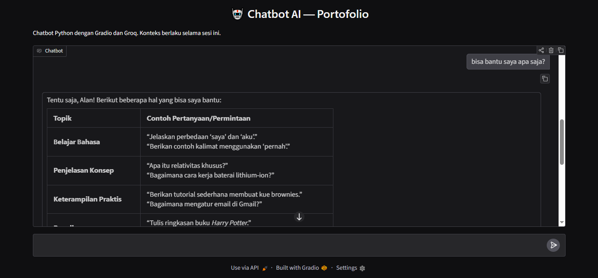

# 🤖 Chatbot AI — Portofolio Python

Aplikasi chat sederhana menggunakan **Python**, **Gradio**, dan **Groq API** (`openai/gpt-oss-20b`). Proyek latihan AI Engineer untuk menunjukkan integrasi LLM dengan UI web dan riwayat konteks percakapan.

## Fitur
- Chat berbasis web menggunakan Gradio
- Jawaban AI dalam bahasa Indonesia
- Konteks hingga 3 pasangan pesan terakhir di sesi aktif
- Penanganan error API dasar
- API key diambil dari environment variable, bukan ditulis dalam kode

## Jalankan di komputer
1. Instal Python 3.10+.
2. Unduh proyek dan jalankan `pip install -r requirements.txt`.
3. Salin `.env.example` menjadi `.env`, lalu isi **di komputer sendiri** dengan `GROQ_API_KEY` dan `GRADIO_PASSWORD`.
4. Jalankan `python app.py` dan buka alamat lokal yang tampil.

## Jalankan di Google Colab
1. Upload file proyek atau unzip bundel proyek.
2. Jalankan `%pip install -r requirements.txt`.
3. Tambahkan `GROQ_API_KEY` dan `GRADIO_PASSWORD` pada **Colab Secrets** dan aktifkan Notebook access.
4. Di sebuah sel, jalankan:

```python
import os
from google.colab import userdata
os.environ["GROQ_API_KEY"] = userdata.get("GROQ_API_KEY")
os.environ["GRADIO_PASSWORD"] = userdata.get("GRADIO_PASSWORD")
os.environ["GRADIO_SHARE"] = "true"  # Link dapat diakses publik; ada password
!python app.py
```

**Jangan** menampilkan nilai secret dalam notebook atau mengunggahnya ke GitHub.

## Catatan keamanan dan batasan
- File `.env` dan riwayat pengguna tidak boleh dipublikasikan.
- Link dengan `GRADIO_SHARE=true` dapat diakses siapa pun yang mengetahui URL, meskipun ada halaman login. Jangan bagikan kredensial.
- Riwayat hanya berlaku selama sesi Gradio, **belum** disimpan lintas sesi. Ini sengaja berbeda dari Chatbot Versi 13 privat yang memakai file Google Drive bersama, supaya demo portofolio tidak membocorkan percakapan pengunjung lain.
- Demo ini belum memiliki pembatasan permintaan per pengguna, observabilitas, atau penyimpanan multi-pengguna yang aman. Jangan gunakan sebagai layanan publik produksi.
- Penggunaan Groq mengikuti kuota dan ketentuan paket akun.

## Teknologi
- Python
- Gradio
- Groq Python SDK
- Python dotenv (untuk pengembangan lokal)

## Ide pengembangan
- Tambahkan pengujian unit
- Simpan riwayat per pengguna dengan login yang benar
- Tambahkan pembatasan permintaan dan pemantauan kesalahan


## Screenshot Aplikasi

Berikut tampilan chatbot AI yang saya buat
menggunakan Python, Gradio, dan Groq API.




## Cara Kerja Sistem

1. Pengguna memasukkan pertanyaan melalui Gradio.
2. Python menerima pesan dari pengguna.
3. Program mengambil konteks percakapan sebelumnya.
4. Pertanyaan dan konteks dikirim ke Groq API.
5. Model LLM menghasilkan jawaban.
6. Jawaban ditampilkan kembali melalui Gradio.

### Arsitektur

Pengguna
   ↓
Gradio Web Interface
   ↓
Python Backend
   ↓
Groq API (LLM)
   ↓
Respons AI
   ↓
Gradio Web Interface

### Pengelolaan Memori

Aplikasi menggunakan riwayat percakapan sementara.
Beberapa pesan terakhir dikirim kembali ke model
agar AI dapat memahami pertanyaan lanjutan.

Riwayat tidak disimpan secara permanen pada
versi portofolio ini.
